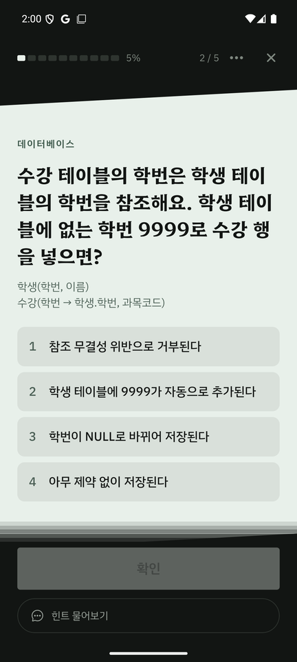
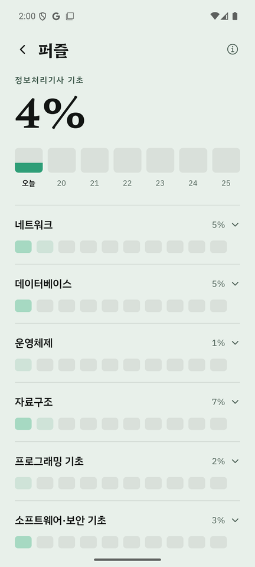
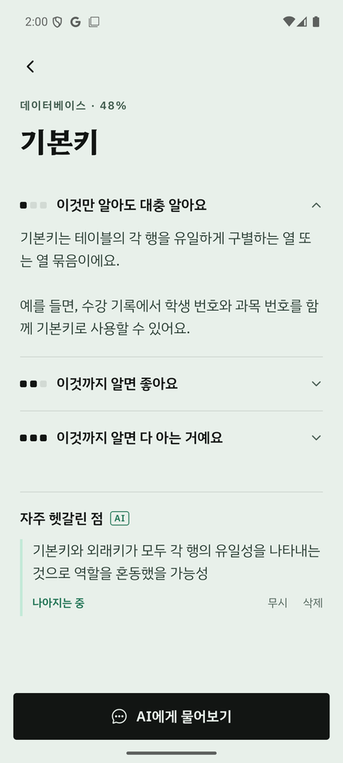
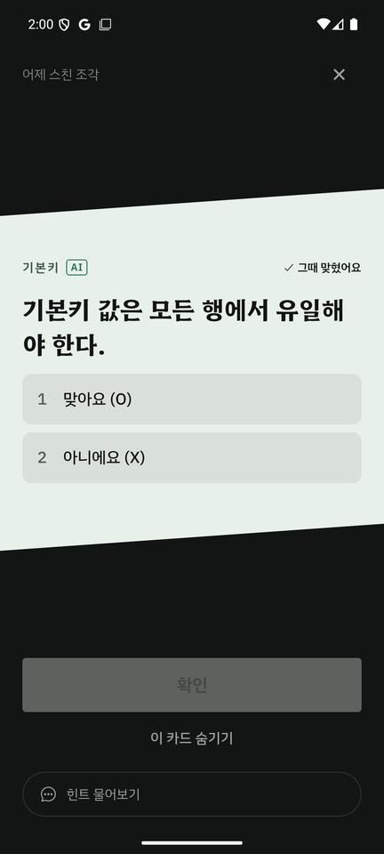
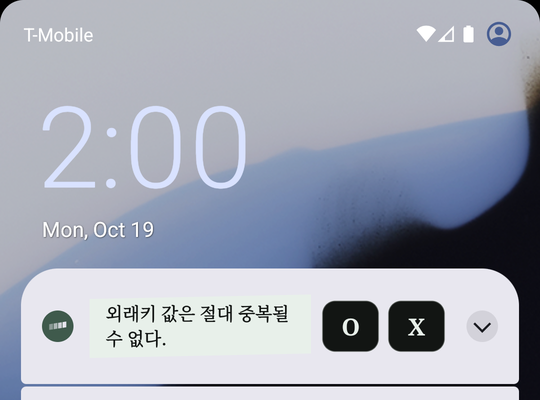
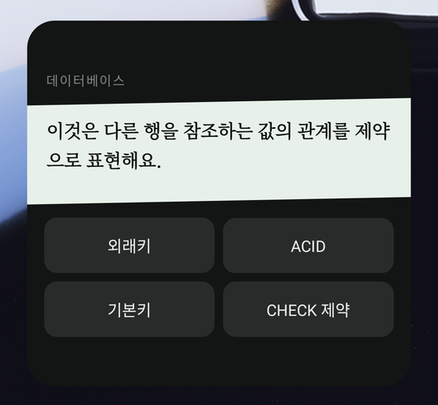

# 틈지식

[시연용 APK 다운로드 · Google Drive](https://drive.google.com/file/d/17EUrKKdw9NOm-5nluntDH5FhYkvwNrCk/view?usp=drive_link) · [설치 가이드](docs/INSTALL.md)

**잠깐의 틈에 스치는 지식.** 잠금 화면에서 기초 개념을 스치고, 앱을 열면 그 개념을 한 단계 깊은 문제로 맞춰 가는 자격증 기초 학습 Android 앱입니다.

공부는 시작이 제일 어렵습니다. 틈지식은 공부하러 가게 만드는 대신, 폰을 켤 때마다 짧은 O/X 카드로 지식이 스쳐 가게 합니다. 지식은 퍼즐과 같아서, 틈틈이 주변 조각을 깔아 두면 본격적으로 공부할 때 처음 보는 개념도 들어갈 자리가 보입니다. 앱 안에서는 하루 몇 문제의 상황형 문제로 조각을 더 선명하게 하고, ChatGPT를 연결하면 AI가 학습자가 자주 헷갈리는 지점을 기억해 맞춤 카드와 확인 문제를 만듭니다.

과목은 받아서 넣는 방식이라 자격증마다 늘릴 수 있으며, 지금은 정보처리기사 기초와 SQLD 맛보기가 있습니다.

| 오늘의 문제 | 해상도 퍼즐 | 개념과 자주 헷갈린 점 | AI 카드 다시 풀기 |
| :---: | :---: | :---: | :---: |
|  |  |  |  |

| 잠금 화면 카드 | 홈 위젯 |
| :---: | :---: |
|  |  |

## 주요 기능

- **잠금 화면 카드와 홈 위젯** — 소리·진동 없이 잠금 화면에 놓이는 O/X 카드와 크기별 홈 위젯(O/X, 용어 맞히기 4지선다·3지선다)입니다. 앱을 열지 않고 탭 한 번으로 답하며, 답은 학습 기록에 남습니다. 카드가 바뀌는 간격과 방해 금지 시간을 정할 수 있습니다.
- **오늘의 문제** — 앱을 열면 하루 3·5·10개 중 정한 만큼 상황형 문제가 하나씩 나옵니다. 문제가 기댄 카드("스친 조각")를 눌러 그때의 카드를 다시 풀 수 있습니다.
- **해상도와 퍼즐** — 개념마다 0–100%의 해상도와 반감기가 있어, 맞히면 선명해지고 시간이 지나면 흐려집니다. 과목의 진척은 조각 색으로 보입니다.
- **AI 코치 (선택)** — ChatGPT를 연결하면 7일 학습 계획, 문제의 힌트와 해설, 개념 본문 일부를 골라 묻기를 쓸 수 있습니다.
- **AI 맞춤 학습 (선택)** — 설정에서 켜면 오답과 이 앱의 대화에서 자주 헷갈린 점을 근거와 함께 기억합니다. 검토된 기준 자료 안에서 짧은 O/X 카드를 만들어 카드 덱에 조금 섞고, 하루 뒤 다른 상황의 확인 문제로 다시 묻습니다. 맞히면 "나아지는 중", 다른 날 다른 문제로 한 번 더 맞히면 "이젠 맞혀요"가 됩니다. AI가 만든 카드와 문제에는 `AI` 표시가 붙고, 기준 자료 보기·카드 숨기기·헷갈린 점 무시와 삭제를 제공합니다.

AI 맞춤 카드·확인 문제 생성은 전체 학습 개념으로의 확대를 목표로 하며, 현재는 **스택·큐·기본키·외래키 네 개념**까지 구현했습니다. 일반 AI 질문·힌트·해설·7일 학습 계획은 이 네 개념에 한정되지 않습니다.

정답 판정, 해상도와 복습 일정 계산은 앱 규칙이 맡고, AI는 사람마다 다른 헷갈림을 다루는 데에만 씁니다. 기본 학습은 ChatGPT 연결 없이 오프라인으로 동작합니다.

## 과제 기술 요소

| 요소 | 구현 |
| --- | --- |
| Long-term Memory | 학습자·과목·개념별 헷갈림을 근거(오답, 대화 발언, 확인 문제 결과)와 함께 SQLite에 저장합니다. 상태는 AI의 확신도가 아니라 근거 규칙으로 앱이 정하고, 이후 카드 생성·확인 문제·7일 계획에 다시 씁니다. |
| 자동화 워크플로우 | 학습 기록 → AI 추출·생성 → 생성자 답을 가린 별도 검토 → Kotlin 카드 덱(잠금 화면·위젯) → 앱 밖 응답 수집 → SQLite 반영 → 확인 문제와 메모리 갱신이 하나로 이어집니다. 앱이 앞에 있고 동의와 연결이 유효할 때만 AI를 호출합니다. |

## 구조

| 구성 | 역할 |
| --- | --- |
| React Native · Expo SDK 57 · TypeScript | 학습 화면과 앱 규칙(채점, 해상도, 복습, 덱 구성) |
| Kotlin `gap-android` | 잠금 화면 카드와 홈 위젯, 앱이 꺼져 있을 때의 응답 기록 |
| Kotlin `siwc-android` | ChatGPT 브라우저 인증, 토큰의 Android Keystore 보호, AI 응답 스트리밍 |
| SQLite | 학습 기록, 헷갈림 메모리, 생성 문제의 기준 저장소(버전 있는 마이그레이션, 중복 반영 방지) |

자세한 데이터 흐름은 [구현 아키텍처](docs/ARCHITECTURE.md)에 있습니다.

## 설치와 실행

**[시연용 APK 다운로드](https://drive.google.com/file/d/17EUrKKdw9NOm-5nluntDH5FhYkvwNrCk/view?usp=drive_link)** — 컴퓨터 없이 폰 하나로 실행되는 빌드입니다. 설치와 시연 순서는 [설치 가이드](docs/INSTALL.md)를 따르세요. 시연을 위해 AI 맞춤 학습의 대기 시간(실제 규칙은 카드에 답하고 24시간 뒤·다른 날짜)과 하루 한도만 줄였고, 채점·해상도·복습 계산은 그대로입니다. Android 8.0 이상, arm64 기기를 지원합니다.

**개발 환경** — Node 24 LTS, JDK 17, Android SDK 36이 필요합니다. 로컬 Kotlin 모듈이 있어 Expo Go 대신 Development Build를 씁니다.

```sh
npm ci
npm run check
npx expo prebuild --platform android
npm run android
```

시연용 APK 빌드 방법과 도구 설정은 [빌드 문서](docs/BUILD.md)에 있습니다.

## 검증

- 자동 검사: TypeScript·ESLint·Jest 169개, Kotlin/JUnit 55개(인증 38, 카드·위젯 17), 콘텐츠 구조 검사(72개념, 틈새 카드 144장, 앱 문제 72개).
- Android 16 에뮬레이터(API 36): 화면 폭 360·411dp × 글씨 100·200%, 세로 고정, 잠금 화면·위젯 동작, 데이터를 유지한 채 업데이트 설치.
- 실제 ChatGPT 계정: 대화 → 헷갈린 점 저장 → AI 카드 생성·검토 → 위젯·잠금 화면 응답 → 확인 문제 → "이젠 맞혀요"까지 한 흐름.
- 실제 기기: 갤럭시 A36에서 잠금 화면 카드 표시.

검사 범위와 시점별 결과는 [검증 결과](docs/VERIFICATION.md)에 정리했습니다.

## 참고

삼성 폰은 잠금화면 알림 스타일을 "카드"로 두어야 잠금 화면에서 카드 내용이 보입니다.

## 문서

- 제출 자료: [프로젝트 기획서](docs/PROJECT_PROPOSAL.md) · [기능·비기능 요구사항](docs/REQUIREMENTS.md) · [발표 원고](docs/PRESENTATION.md) · [발표 자료 PPTX](presentation/teum-knowledge-course-project.pptx)
- 설계: [구현 아키텍처](docs/ARCHITECTURE.md) · [V4 구현 계획](docs/PLAN_V4.md) · [콘텐츠 출처 상태](docs/CONTENT_SOURCES.md)
- 사용: [설치 가이드](docs/INSTALL.md) · [빌드](docs/BUILD.md)
- 검증과 기록: [검증 결과](docs/VERIFICATION.md) · [최종 검수 수정](docs/FINAL_FIXES.md) · [ChatGPT 연동 상태](docs/SIWC_STATUS.md) · [개발 기록](docs/WORK_LOG.md)

구성원은 **송영준 · 김혜민 · 이관주**입니다.

3인 팀 프로젝트입니다. 문제 정의와 기획, 화면 설계, 앱과 Kotlin 모듈 구현, 자동 검증, APK 제작과 문서화를 이 저장소에서 진행했습니다. 단계별 수정과 검증은 Git 이력과 [개발 기록](docs/WORK_LOG.md)에 남겼습니다.
