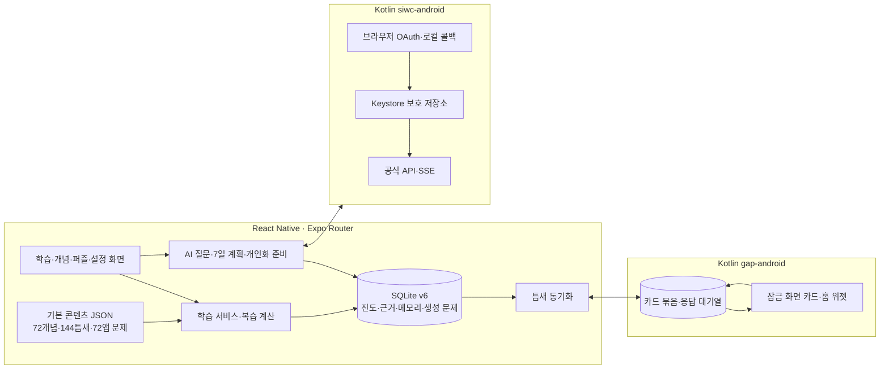
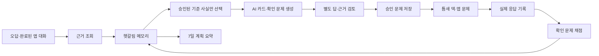

# 틈지식 V4 구현 구조

기준: 2026-10-19. 실제 코드의 데이터 흐름을 설명한다. 기능 목록과 수용 기준은 [REQUIREMENTS](REQUIREMENTS.md), 실행 근거는 [VERIFICATION](VERIFICATION.md)에 있다.

## 두 학습 층과 저장 책임

SQLite는 학습 기록의 영구 기준이다. `LearningRepository`는 문제 제출과 진도·해상도·메모리·응답 outbox를 트랜잭션으로 묶고, 같은 세션 재제출을 멱등 처리한다. 콘텐츠 JSON은 포함된 기본 학습 자료다. 앱이 닫혀 있어도 카드가 동작해야 하므로 Kotlin 틈새 모듈은 별도 상태 파일에 카드 묶음과 응답 대기열을 보관한다.

1. 앱은 학습 기록·복습 차례·생성 카드 상태로 덱을 만들고 Kotlin에 전달한다. 기본 카드가 우선이며 AI 카드 비율은 덱의 20% 이하다.
2. 잠금 화면 카드와 위젯은 Kotlin의 준비된 덱에서 문제를 보여 준다. AI 네트워크 요청을 백그라운드에서 새로 시작하지 않는다.
3. 응답 이벤트에는 ID와 학습 소유자를 붙인다. 앱이 열리면 이벤트를 SQLite에 먼저 반영하고 커밋 후 ack한다. 다시 읽어도 같은 ID는 중복 가산하지 않는다.
4. 학습자·과목·설정이 바뀌면 동일한 동기화 큐에서 새 덱을 전달해 옛 학습자의 카드가 되살아나지 않게 한다.

앱 문제와 틈새 카드의 복습 일정을 서로 덮어쓰지 않는다. 앱 문제는 개념별 해상도와 간격을, 틈새 카드는 별도 응답 간격을 관리한다. 퍼즐은 맞힌 조각과 본 조각을 구분해 보여 준다.

## SIWC 경계

`siwc-android`는 브라우저 로그인, 임시 127.0.0.1 HTTP 콜백, PKCE/state, 토큰 교환·검증, 보호 저장, 갱신, 모델 조회와 응답 스트림을 Kotlin 안에서 처리한다. 자격증명은 Android Keystore가 보호하는 파일에 있고 JS·SQLite·로그에는 전달하지 않는다. JS는 연결 상태, 비민감 프로필 식별자, 모델과 응답 텍스트만 받는다.

실제 계정의 응답 경로는 이전 개발 기록에서 확인했다. 신규 계정 로그인, 토큰 수명 전체, 물리 기기별 브라우저 복귀까지 포괄적으로 검증한 것은 아니다. 정확한 경계는 [SIWC_STATUS](SIWC_STATUS.md)를 따른다.

## 장기 기억과 자동화

`confusion_memories`는 학습자·과목·개념별 헷갈림과 근거·상태를 저장한다. 저장한 요약은 다음 카드 생성과 7일 계획 입력에 사용하므로 단순 대화 보관이 아니다. 사용자는 무시·삭제할 수 있고, 기록 초기화에도 포함된다. 같은 근거의 재생성과 늦은 AI 응답에 따른 부활은 generation/checkpoint와 소유권 재검사로 막는다.

`generation-basis.json`에 승인된 기초 사실과 조건을 둔다. V4 생성 범위는 정보처리기사 기초의 스택·큐·기본키·외래키 네 개념이다. 생성 후보는 길이·형식·금지 표현 검사를 통과하고, 생성자의 정답을 숨긴 별도 답·근거 검토 뒤에만 승인된다. 학습자에게 보이는 새 문제 해설은 승인된 사실에서 앱이 구성한다. 자동 검토는 사실성 보증이 아니다.

개인화 준비는 앱이 앞에 있고 동의·연결·모델·새 근거가 있을 때, 마지막 학습 변화 뒤 대기하여 시작한다. 요청은 사용자 채팅, 필요한 계획, 배경 준비의 우선순위로 직렬화한다. 학습자·과목·scope·동의가 달라지면 요청 결과를 저장하지 않는다. 일일 요청·카드·확인 문제 한도와 입력 fingerprint가 중복 생성을 줄인다.

AI 카드에 응답한 뒤 일반 규칙에서는 24시간이 지나고 날짜가 바뀌어야 다른 상황의 확인 문제를 낼 수 있다. 한 번 맞히면 `improving`, 별도의 후속 확인 정답이면 `resolved`로 바꾸고 생성 카드의 이후 덱 편입을 중단한다. 이 상태는 앱의 채점 규칙이다. 시연용 빌드는 이 기다림과 한도를 짧게 하므로 결과를 일반 배포 규칙의 장시간 검증으로 해석하지 않는다.

## 동의·오류·보안

기본 문제는 ChatGPT 연결 없이 사용한다. AI 질문·계획에는 학습 정보 전송 동의가 필요하고, 자동 맞춤 학습은 별도 설정으로 켠다. 연결 실패나 모델 한도에 걸리면 기본 콘텐츠로 학습을 이어간다. 생성 카드에는 AI 표시와 근거를 제공하고 숨기기를 허용한다. 잠금 화면에는 카드 문장만 싣고 개인 대화 원문은 넣지 않는다.

시연용 APK는 [Google Drive](https://drive.google.com/file/d/17EUrKKdw9NOm-5nluntDH5FhYkvwNrCk/view?usp=drive_link)에서 다운로드할 수 있다. 빌드·실행 결과는 [BUILD](BUILD.md)와 [WORK_LOG](WORK_LOG.md), 설치 절차는 [INSTALL](INSTALL.md)에 기록한다. 물리 기기별 동작은 별도 확인 범위다.
