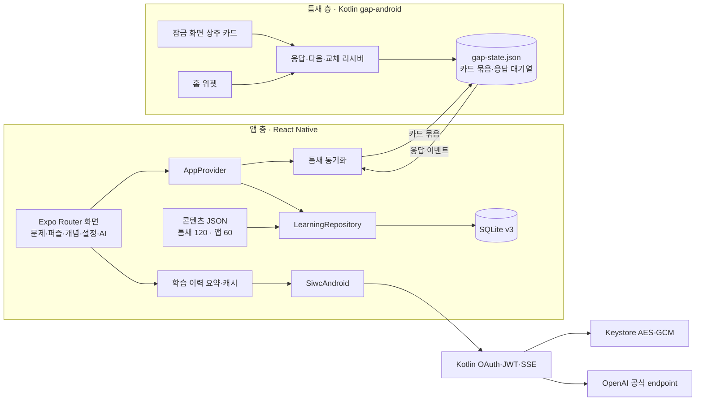

# 구현 구조

## 두 층의 데이터 흐름

SQLite가 학습 데이터의 영구 기준이다. 틈새 층은 앱이 꺼져 있어도 동작해야 하므로 Kotlin이 자기 상태 파일 하나를 가진다.

1. 앱이 열리거나 학습 상태가 바뀌면 동기화 서비스가 네이티브 응답 대기열을 읽어 SQLite `gap_events`·`gap_progress`에 반영한다. 이벤트 ID로 중복을 막고, 정답 여부는 카탈로그로 다시 계산한다. 커밋 뒤에만 확인(ack)한다.
2. 이어서 카드 묶음(약 30장: 복습 차례 → 처음 보는 조각 → 나머지)과 설정을 네이티브에 통째로 넘긴다. 같은 큐로 직렬화해 삭제·프로필 전환 중 이전 learner의 묶음이 되살아나지 않게 한다.
3. 네이티브는 묶음을 돌며 카드를 보여 준다. 응답하면 즉시 결과를 보여 주고 이벤트를 쌓는다. 비정확 반복 알람으로 간격마다 교체하고, 시간대 밖에서는 잠금 화면 카드를 내린다. 위젯은 사용자가 놓은 표면이라 토글·시간대와 관계없이 묶음을 따른다. 재부팅·앱 업데이트 뒤 다시 놓는다.

## 채점과 일정

- 앱 층: 세션·사용자·진도 revision을 다시 검사하고 attempt/progress/memory/outbox를 한 트랜잭션으로 기록한다. 같은 세션의 반복 제출은 기존 결과를 돌려준다. 조기 연습은 진도와 복습 날짜를 바꾸지 않는다. 오답이면 그 조각을 다음 날 틈새에 다시 놓는다.
- 틈새 층: 정답이면 1·3·7일, 오답이면 다음 날. 앱 채점과 서로 덮어쓰지 않는다.
- 퍼즐: 앱에서 채점 정답 = 맞춘 조각, 틈새에서 한 번 이상 응답 = 본 조각.

## AI

AI 맥락은 현재 개념·학습 진도·관련 취약 개념·최근 관련 결과로 제한한다. 등록별 learner를 분리하며 최초 연결만 기기 기본 기록을 연결한다. 완료된 설명만 입력 fingerprint별 7일·100개까지 보관한다. AI는 사용자가 요청할 때만 실행한다. 인증 네트워크 작업은 자격증명 잠금 밖과 Expo IO 디스패처에서 실행한다.
