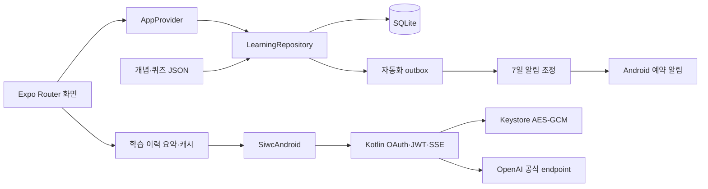

# 구현 구조

SQLite가 학습 데이터의 영구 기준입니다. 채점은 세션·사용자·진도 revision을 다시 검사하고 attempt/progress/memory/outbox를 하나의 트랜잭션으로 기록합니다. 같은 세션의 반복 제출은 기존 결과를 반환합니다. 조기 연습은 정답률·복습 날짜를 바꾸지 않습니다.

AI 맥락은 현재 개념·학습 진도·관련 취약 개념·최근 관련 결과로 제한합니다. 등록별 learner를 분리하며 최초 연결만 기기 기본 기록을 연결합니다. 이메일로 계정을 합치지 않습니다. 완료된 설명만 입력 fingerprint별 7일·100개까지 보관합니다.

알림은 기본 off이며 권한 허용 후 7일 최대21개 예약을 조정합니다. OS 예약과 deterministic ID/fingerprint를 비교해 중복을 줄입니다. AI는 앱 화면에서 사용자가 요청할 때만 실행합니다.
