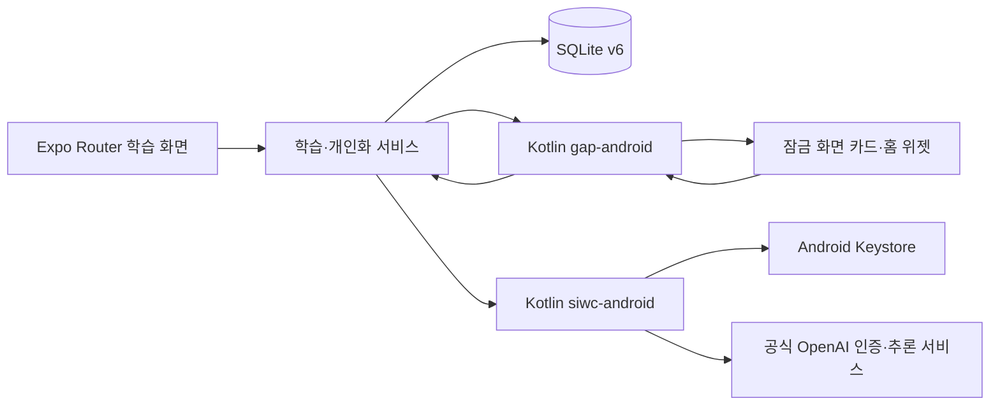

# 틈지식 기능·비기능 요구사항 명세

기준: 2026-10-19 V4. 검증 근거는 [VERIFICATION](VERIFICATION.md)에 정리했다.

## 기능 요구사항

| ID | 우선순위 | 요구사항과 수용 기준 | 상태 |
| --- | --- | --- | --- |
| FR-01 | Must | 온보딩에서 과목을 받고 하루 문제 수 3·5·10개 중 하나를 고른다. 과목별 기록은 분리한다. | 구현 |
| FR-02 | Must | 기본 개념·문제를 연결 없이 이용하고, 앱 재실행 후 학습 기록을 복원한다. | 구현·자동 검증 |
| FR-03 | Must | 앱 문제의 제출을 한 번만 반영하고 정답·해설·진도·복습 일정을 일관되게 저장한다. | 구현·자동 검증 |
| FR-04 | Must | 잠금 화면 O/X 카드와 홈 위젯이 준비된 덱을 보여 주고, 응답을 앱 기록에 중복 없이 반영한다. | 구현·에뮬레이터 검증 |
| FR-05 | Must | 카드 간격과 방해 금지 시간을 사용자가 정한다. 알림 권한을 거부해도 앱 학습은 계속된다. | 구현 |
| FR-06 | Must | 연결 가능한 계정에서 SIWC 브라우저 인증 후 개념 질문, 힌트·해설, 7일 계획을 요청한다. | 구현·실제 계정 경로 검증 |
| FR-07 | Must | 학습 정보 전송 동의와 AI 맞춤 학습 활성화를 구분한다. 맞춤 학습은 기본 꺼짐이다. | 구현·자동 검증 |
| FR-08 | Must | 오답과 완료된 앱 대화의 근거를 개념별 헷갈림 메모리로 저장하고 이후 AI 요청에 활용한다. | 구현·자동/실제 계정 검증 |
| FR-09 | Must | 승인된 기준 자료 범위에서 AI O/X 카드를 만들고 별도 답·근거 검토 후 일정 비율 이하로 덱에 편입한다. | 구현·자동/실제 계정 검증 |
| FR-10 | Must | AI 카드 응답 뒤 원래 규칙으로 24시간·다른 날짜 조건의 확인 문제를 내고 정답 결과로 메모리 상태를 갱신한다. | 구현·원래 규칙 자동 검증; 단축 규칙 실제 계정 검증 |
| FR-11 | Must | AI 카드·문제에 AI 표시를 하고 근거를 보이며, 사용자가 카드 숨김·헷갈림 무시·삭제를 할 수 있다. | 구현·에뮬레이터 검증 |
| FR-12 | Should | 개념별 해상도·퍼즐·7일 계획과 다시 풀기를 보여 준다. | 구현 |
| FR-13 | Should | ChatGPT 공식 구독 사용량 페이지를 앱 안 브라우저로 연다. 표시 계정이 SIWC 계정과 다를 수 있음을 안내한다. | 구현·실제 계정 검증 |
| FR-14 | Must | 학습 기록 초기화·전체 데이터 삭제에서 개인화 데이터를 함께 제거하고, 늦은 AI 결과가 삭제 내용을 되살리지 않는다. | 구현·자동 검증 |

## 비기능 요구사항

| ID | 항목 | 검증 가능한 기준 | 현재 근거 |
| --- | --- | --- | --- |
| NFR-01 | 오프라인 기본 학습 | 네트워크·ChatGPT 연결 없이 포함된 콘텐츠의 문제와 기록 기능을 사용할 수 있다. | 저장소 테스트·기본 앱 구조 |
| NFR-02 | 데이터 일관성 | 같은 제출·틈새 이벤트를 다시 전달해도 진도는 한 번만 바뀌고, 실패한 저장은 트랜잭션으로 되돌린다. | SQLite/Jest 검사 |
| NFR-03 | 계정 분리 | 학습자·과목·scope가 바뀐 뒤 완료된 이전 AI 결과가 다른 기록으로 저장되지 않는다. | 개인화·요청 조정 회귀 검사 |
| NFR-04 | 인증 보호 | 토큰은 JS·SQLite·로그·Git에 저장하지 않고 Android Keystore가 보호하는 네이티브 저장소에 둔다. | Kotlin 구현·fixture 검사 |
| NFR-05 | 생성물 품질 경계 | 승인된 사실·조건과 맞지 않거나 형식에 맞지 않는 생성물은 노출하지 않는다. | 생성·검토 검사, 기준 자료 4개념부터 제한 |
| NFR-06 | 접근성과 화면 적응 | Android 휴대폰 세로 화면에서 360/411dp와 글씨 100/200%의 주요 동작 버튼에 도달할 수 있다. | API36 화면 검사, 갤럭시 A36 잠금 화면 확인 |
| NFR-07 | 실행 독립성 | 시연용 APK는 Metro 없이 API36 arm64 에뮬레이터에서 시작한다. | 로컬 release APK 설치·실행 기록 |
| NFR-08 | 정보 전송 제어 | 연결·전송 동의·별도 맞춤 학습 활성화 없이는 개인화 준비를 시작하지 않는다. 동의 철회·범위 변경 시 진행 중 결과를 취소 또는 폐기한다. | 저장소 회귀 검사 |
| NFR-09 | 장애 처리 | AI 연결 실패·한도 초과 때 기본 학습 흐름을 유지하며 재시도/연결 상태를 보여 준다. | 앱 구현·관련 자동 검사 |

## 시스템 경계

구체적인 이벤트 소유권, 자동화 순서와 복구 규칙은 [ARCHITECTURE](ARCHITECTURE.md)에 기록한다. 시연용 APK는 AI 맞춤 학습의 대기·한도만 단축한다. 위 FR-10의 24시간 규칙은 일반 배포 빌드 기준이다.
