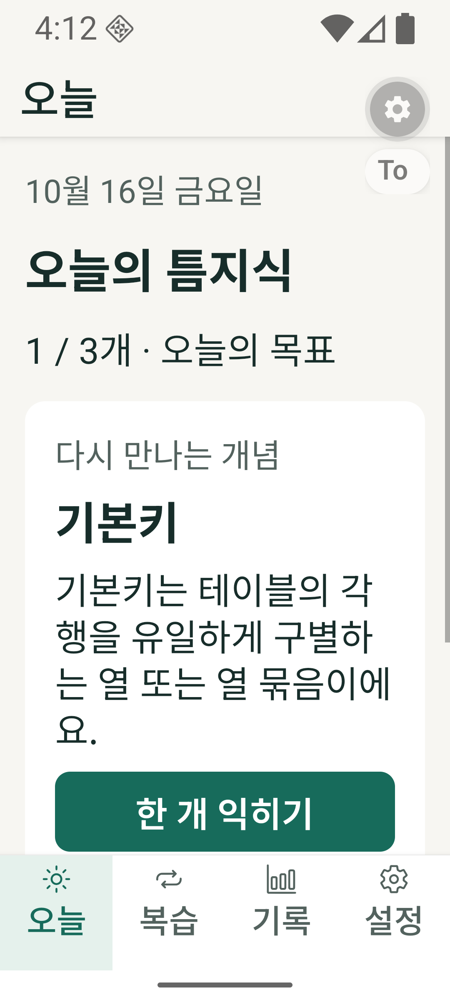
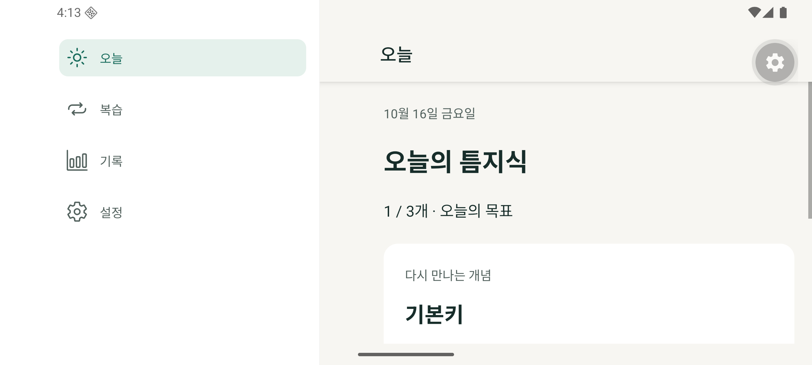

# FIX.C2 재검수와 FIX.C3 수정

2026-10-16. 독립 재검수 대상은 `bba341bf9ae37f385ab6c27ef2e03ad296f4764a`(FIX.C2)다. 재검수 중 사용자가 즉시 수정을 요청하여 아래 결함을 FIX.C3에서 수정했다. 수정 후 결과는 구현자의 회귀 검증이며, 수정본에 대한 별도 독립 재검수 완료를 뜻하지 않는다.

## 재검수 결과와 수정

| 항목 | 수정 전 증거·영향 | FIX.C3 동작 | 검증 |
| --- | --- | --- | --- |
| P1 — Expo 실행 큐 차단 | `SiwcModule.listModels/signOut`이 동기 HTTP를 기본 AsyncFunction 큐에서 실행. 설치된 Expo57 소스의 기본 큐는 단일 HandlerThread라 다른 상태 조회·취소 호출이 네트워크 뒤에서 대기 | 두 네트워크 진입점을 Coroutine + Dispatchers.IO로 분리. 짧은 상태 변경과 응답 취소는 기존 큐에서 처리 | SDK57 모듈 구현·공식 문서 대조, Kotlin 컴파일·APK 빌드. 느린 실제 서버에 대한 JS bridge 지연 측정은 미수행 |
| P2 — 이전 인증이 새 서비스 종료 | 실제 SiwcManager를 메모리 저장소·가짜 Android service 경계로 실행. A의 stopService 직전 B를 시작하면 B가 authorizing인데 서비스는 종료되는 실패 재현 | 인증 시도 확인과 서비스 정리를 같은 잠금 안에서 처리. 시작 intent·취소 PendingIntent·timeout에 attemptId/startId 연결. 이전 시도의 취소·timeout 무시 | SiwcManagerTest에서 A 정리 중 B가 기다리고, 이후 B의 서비스가 유지되며 오래된 취소가 거부됨 |
| P2 — 다음 날 알림 대상 오류 | 오늘 목표 완료 뒤 다음 날의 `nextConcept`는 새 개념인데 예약은 이미 배운 첫 개념을 선택하는 Jest 실패 | 각 예약 시각을 기준으로 due/new 대상을 계산. 알림 탭 시 현재 학습 기록으로 다시 선택. 목표 완료·학습 대상 없음은 오늘 화면으로 이동 | 미래 복습 시각 전후 대상, 오늘 완료, 전 개념 미도래, 과거 payload·다른 learner 검사 |
| P2 — 빠른 AI 응답의 후속 맥락 누락 | completed 이벤트가 startResponse Promise보다 먼저 도착하면 다음 요청에서 이전 assistant 답변이 빠짐. 일반 순서는 통과, 빠른 순서만 실패 | 초기 buffer와 일반 이벤트를 동일 handler로 처리. 완료·캐시 응답의 질문/답변 쌍 유지 | 실제 AI 화면 RNTL 테스트에서 두 순서 모두 후속 요청의 이전 답변 포함 확인 |
| P2 — 인증 복귀 화면의 무한 진행 문구 | auth.ready를 제공해도 계속 “확인하고 있어요” 표시하는 RNTL 실패 | authorizing/성공/플랜 미동의/실패/취소/재연결을 표시. 이전 계정이 ready여도 새 연결 실패·취소 결과를 구분 | 성공·진행·플랜 미동의·실패·취소·만료 상태 테스트 |

## 함께 보완한 상태 처리

- 거부된 오래된 인증 커밋은 현 세션의 lease를 무효화하거나 진행 중 호출을 취소하지 않는다. `SessionRegistry.update`는 변경 검증을 먼저 수행한다.
- 프로필 목록의 connected와 상태 화면이 동일한 만료·갱신 가능 기준을 사용한다.
- HTTP 오류의 status/code/parameter/body shape/server request ID를 허용된 문자열 형식으로만 JS에 전달한다. 원문 응답·인증 토큰은 전달하지 않는다. refresh 없는 401에서도 토큰을 보존하면서 연결 확인 안내와 원래 요청 진단을 유지한다.
- 권한 거부, 사용량 한도, 일시적인 usage 서비스 장애를 구분한다. 모델 목록 재시도 성공 시 연결 안내도 갱신한다. POST 자동 재전송은 추가하지 않았다.
- 모든 알림 reconciliation 진입점에서 최신 성공 결과가 이전 오류 표시를 해제한다. 앱을 재실행하지 않고 학습 상태 변경 후 복구되는 통합 테스트를 추가했다.
- 하단 탭이 시스템 inset을 담당하는 휴대폰 화면은 본문에서 bottom inset을 중복 적용하지 않는다. stack 화면과 가로 sidebar에서는 bottom inset을 유지한다.

## 검증

- 수정 전 기존 검사: Jest26개·Kotlin30개·typecheck/lint·콘텐츠60개/120문항·Android debug/AndroidTest build 통과. 기존 검사만으로 위 결함을 발견할 수 없었다.
- 추가 재현: Kotlin 서비스 경쟁 실패1개, Jest 알림·빠른 응답·복귀 화면 실패3개. 일반 순서 AI 응답은 대조군으로 통과했다. 로컬 `artifacts/astra-review-c2`에 수정 전 fixture/log를 보존했다.
- 수정 후: `npm run check` — TypeScript strict·ESLint·Jest40개·콘텐츠60개/120문항 통과.
- 수정 후: Kotlin/JUnit34개 통과. 기존30개에 manager 경쟁1개·오류 진단2개·오래된 커밋1개를 추가했다.
- `:app:assembleDebug`와 `:app:assembleDebugAndroidTest` 통과. ABI는 arm64-v8a다.
- API36 ARM64: 360/412dp × 글씨100/200%, 실제 가로100%의 5개 TabLayoutTest 통과. 새 APK 설치 후 화면을 확인했고 fontScale/density/rotation을 원복했다. 학습 DB는 삭제하지 않았다.

재현 명령:

```sh
npm run check
# JDK17 / Android SDK36 환경
./android/gradlew -p android :siwc-android:testDebugUnitTest :app:assembleDebug :app:assembleDebugAndroidTest -PreactNativeArchitectures=arm64-v8a
# 앱과 AndroidTest APK 설치, Metro8081 실행, teum-api36 합성 learner 준비 후
python3 scripts/native-layout-check.py
```

## 범위와 한계

FIX.C1의 삭제/알림 경쟁·terminal refresh·명시적 플랜 재동의·프로필 모델 격리·초기화 알림 off 검사는 계속 통과한다. 확대 탭과 가로 대비는 API36 에뮬레이터에서 재확인했다. 단일 에뮬레이터의 화면 크기·글씨 배율 변형이며 여러 제조사의 Android 실기기 검증으로 집계하지 않는다.

실제 계정 OAuth, 서버의 실제 refresh 회전, 실제 AI response.completed, 실기기 알림, 전체 콘텐츠 출처 대조, 의존성 취약점 대응, 외부 배포용 서명은 여전히 미검증/미완료다. 사람 모집·5명 테스트·설문은 추후 과제 조건이다. 제품 방향 초안과 기존 미추적 문서는 이번 결함 수정 범위에 포함하지 않았다.

근거: [OpenAI 오류·복구 계약](https://developers.openai.com/siwc/token-sharing-open-source/errors-and-recovery), [Expo 모듈 API](https://docs.expo.dev/modules/module-api/), [Expo SDK57](https://docs.expo.dev/versions/v57.0.0/).

## 최종 산출물

- 개발용 APK: `artifacts/teum-knowledge-0.1.0-dev-arm64.apk`, 94,444,538 bytes, Git 제외.
- SHA-256: `21de35ccfa7ec380643b5f3f48fab6eb3ad3ae3418157c31910fde674a17b9e3`.
- Android debug / Development Build / arm64-v8a, Metro 서버 필요. 서명된 외부 배포 APK가 아니다.
- 소스 checkpoint FIX.C3. 실제 커밋은 로컬 artifact metadata와 백업 상태 기록에 연결한다.



