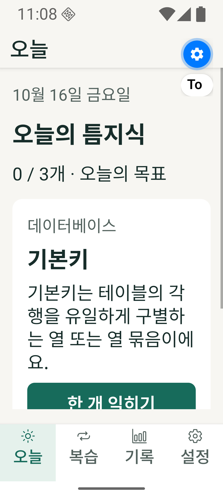
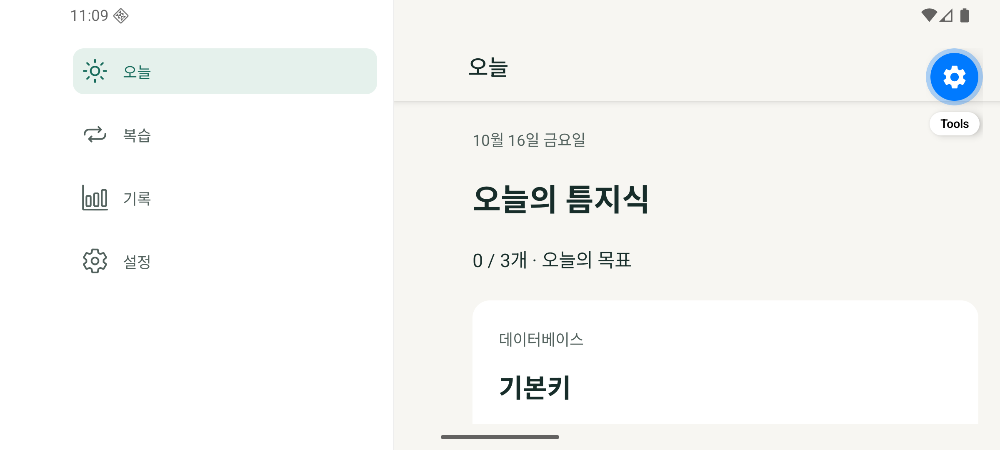

# 검수 결함 수정 — FIX.C1

기준: 2026-10-16. `563cab0`의 검수 보고서7건을 Sol6.1이 수정했다. 아래는 구현자 회귀 검증 결과이며 Astra 독립 재검수는 아직 수행하지 않았다.

| 검수 ID | 수정 동작 | 검증 |
| --- | --- | --- |
| 1 삭제/예약 경쟁 | 예약·삭제·프로필 전환·인증 프로필 동기화를 repository별 큐로 직렬화. OS await 뒤 learner/revision 확인, 이미 진행된 stale 예약은 취소. 삭제 후 새 기본 프로필의 빈 예약도 반영 | 실제 SQLite+모의 OS에서 대기 중 삭제, 이미 호출된 schedule 뒤 삭제, FK 오류·잔존 예약 없음 |
| 2 terminal refresh | 6개 공식 만료·폐기 코드와 invalid_token을 분류. 해당 등록의 token만 제거하고 client/subject 유지. refresh가 없는 만료도 재연결. 모델 요청/AI 실패 뒤 UI auth 갱신 | 로컬 MockWebServer6개 코드, transient503·네트워크·invalid_client 보존, 갱신 토큰/만료/scope 함께 저장 |
| 3 플랜 재동의 | connectedWithoutPlan에 “ChatGPT 플랜 사용 허용” 행동 추가. 명시적 허용에서만 prompt=consent, 일반 연결에는 강제 동의 없음. 전체 scope와 기존 client 유지 | URL 계약 Kotlin3개 + 실제 Settings 버튼의 native 인자2개 |
| 4 모델 목록 | 공통 useProfileModels에서 응답을 profile ID로 묶고 effect cleanup으로 늦은 결과 무시. 비연결 상태는 목록 숨김, 실패 뒤 auth 갱신·목록 재시도 제공 | A→B 전환 후 B→A 응답 역순, 연결 해제, 실패·재시도 hook 테스트 |
| 5 확대 탭 | 폰트 배율·safe area를 고려한 bar/item 높이와 lineHeight, 휴대폰 label 위치 고정 | API36 360/412dp 각각100/200% 실제 앱 캡처 및 label bounds 검사 |
| 6 초기화 알림 | 현재 learner의 notificationsEnabled=false를 학습 초기화와 같은 DB transaction에서 저장. 타 learner 설정·인증 유지 | 초기화·repository reopen 후 off 유지, OS 예약0개, 타 learner on 유지 |
| 7 가로 탭 대비 | 왼쪽 탭 active background를 primarySoft로 지정, primary 전경과 함께 적용 | 실제 가로 캡처. #176B5B/#E5F1EC 대비 약5.51:1, 선택 텍스트/아이콘 기준 충족 |

## 검증 결과

- `npm run check`: TypeScript strict·ESLint·Jest26개·콘텐츠 구조60개/120문항 통과.
- `npx expo-doctor`: 21/21 통과. 의존성 버전/lockfile 변경 없음.
- Kotlin/JUnit17개 통과. 기존9개에 OAuth 갱신5개와 authorize 계약3개 추가. 각 terminal error 코드는 하나의 테스트 안에서 각각 요청·저장 결과를 검증한다.
- `:app:assembleDebug`, `:app:assembleDebugAndroidTest` 통과, API36 ARM64 설치 성공.
- TabLayoutTest를 360/412dp×100/200%와 가로100%의5개 조건에서 실행했다. 가로는 명시적 device rotation 및 실제 display width>height assertion으로 추가 확인했다. 글자 배율을 끄지 않았다.
- UI 확인은 기존 Android Development Build에서 수행했다. 학습 데이터 삭제 없이 캡처했고 emulator fontScale/density/rotation은 원복했다.
- Settings 작업 뒤 OS 예약 오류가 나도 이미 반영된 로컬 변경을 새로 읽도록 finally에서 snapshot/auth를 갱신한다.




## 재현 명령

```sh
npm run check
# JAVA_HOME=JDK17, ANDROID_HOME=SDK36 환경에서
./android/gradlew -p android :siwc-android:testDebugUnitTest :app:assembleDebug :app:assembleDebugAndroidTest -PreactNativeArchitectures=arm64-v8a
```

앱/AndroidTest APK를 설치하고 Metro8081을 실행한 뒤 `python3 scripts/native-layout-check.py`를 사용한다. 이 스크립트는 teum-api36 및 이미 온보딩된 합성 학습 프로필에서 실행하며 개인 기기에는 실행하지 않는다. 초기 합성 학습 흐름은 BUILD/VERIFICATION의 native-smoke 절차로 자동 생성할 수 있다. 레이아웃 스크립트 자체는 학습 기록을 지우지 않는다.

## 개발용 APK

- 파일: `artifacts/teum-knowledge-0.1.0-dev-arm64.apk`, Git 제외
- 크기: 94,432,128 bytes
- SHA-256: `9206200211453029858654f4790f654509eecc5c28bf8bae694b719396097f57`
- 종류: arm64-v8a Android debug / Development Build. Metro 연결 필요, 외부 배포 서명용 아님.
- 소스 checkpoint FIX.C1. 실제 커밋 SHA는 로컬 상태 및 artifact metadata에 기록한다.

## 남은 검증

실제 계정의 OAuth 거절→재동의·토큰 회전·AI response.completed, 실기기 알림, 키 유실 fault injection, 전체 콘텐츠 출처 대조, 의존성 audit64건 대응, 서명된 외부 배포는 여전히 미검증/미완료다. 공식 계약 fixture나 emulator layout 성공을 실제 계정 성공으로 표시하지 않는다. 인간 모집·설문·인터뷰는 추후 과제 메모로 유지한다.

공식 계약 근거: [OpenAI 오류 복구·재동의](https://developers.openai.com/siwc/token-sharing-open-source/errors-and-recovery), [Expo SDK57](https://docs.expo.dev/versions/v57.0.0/), [JS 탭](https://docs.expo.dev/router/advanced/tabs/).
