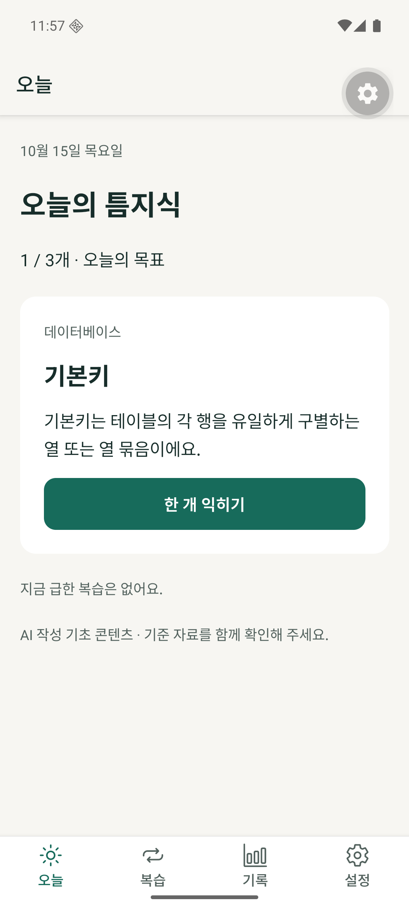
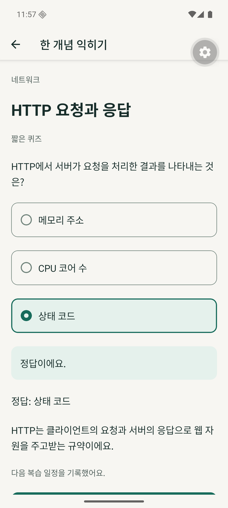
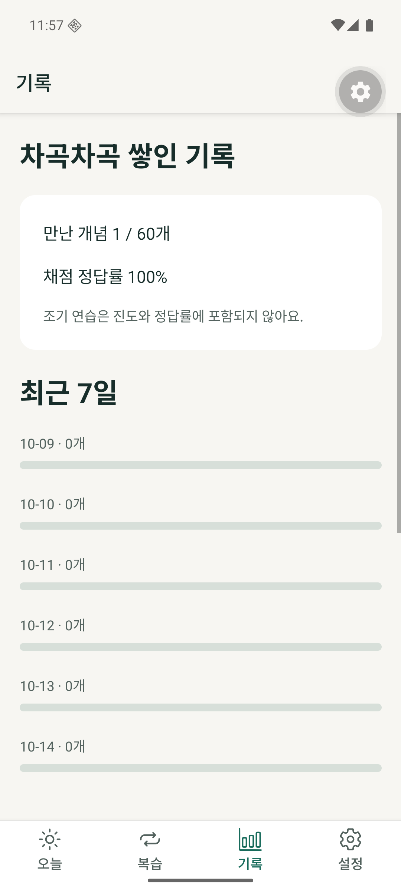

# 개발 검증 결과

2026-10-16 독립 검수의 결함7건을 FIX.C1에서 수정했습니다. [수정·회귀 검증 결과](REVIEW_FIXES.md)와 [수정 전 독립 검수](ASTRA_REVIEW.md)를 구분합니다. Astra 독립 재검수는 대기 중입니다.

기준: 2026-10-15. 자동 검사, 실제 Android 실행, 외부 계정 검증을 구분합니다.

| 항목 | 결과 |
| --- | --- |
| TypeScript strict | 통과 |
| ESLint | 통과 |
| Jest | 17개 통과 (복습·SQLite 트랜잭션·격리·마이그레이션·AI 맥락·알림 계산) |
| 콘텐츠 구조 | 60개/120문항 통과 |
| Expo Doctor | 21/21 통과 |
| Metro Android export | 성공 |
| Kotlin/JUnit | 9개 통과 |
| Android debug build | 성공 |
| API36 ARM64 설치·앱 실행 | 성공. 프로세스 강제 종료 후 재실행에서 진도 유지 확인 |
| UI Automator 학습 경로 | API36 ARM64에서 1개 통합 흐름 통과 (온보딩→개념→정답→오늘 목표→기록) |
| 실제 OAuth / AI response.completed | 미검증 |
| 실제 기기 알림 도착 | 미검증 |
| 콘텐츠 개별 출처 대조 | 미완료·AI 초안 표시 |
| 외부 배포 서명·EAS | 미설정 |

## 검증 범위

Jest의 저장 테스트는 Node SQLite 실제 DB에 schema와 트랜잭션을 실행합니다. 앱 재시작과 동일한 repository reopen, 중복 제출, 실패 trigger 롤백, 프로필 분리와 v1→v2 마이그레이션을 검사합니다. Kotlin은 실제 RSA 서명을 생성해 신원을 검사하고 loopback 소켓에서 경로/state 거부와 포트 대체를 검증합니다. 외부 인증 서버를 fixture 테스트에서 호출하지 않습니다.

## 의존성

`npm audit`는 현재 64건(15 moderate,49 high)을 보고합니다. `npm audit fix`를 시도했으나 해결되지 않았고, 제안에 SDK58 전환이나 Expo44/RN0.72 등 호환되지 않는 변경이 포함되어 강제 적용하지 않았습니다. 많은 항목이 Expo/Metro/Jest 등의 전이 개발 도구에 연결되지만, 실제 도달 가능성과 대응 여부는 출시 전에 별도 검토해야 합니다. 통과한 타입·빌드 검사로 보안 검토를 대체하지 않습니다.

## 추후 메모

실사용자 5명·피드백, 실제 계정·기기 검증, 외부 배포 증빙과 발표는 별도 과제 조건입니다. 자동 테스트를 실제 사용자 테스트 인원으로 세지 않습니다.

## 화면 증거

API36 ARM64 Development Build의 합성 학습 기록입니다. 개발 도구 버튼이 보이는 개발용 화면이며 실사용자 테스트 결과가 아닙니다.

## UI smoke 재현

Metro를 8081에서 실행하고, BUILD 절차에 더해 `:app:assembleDebugAndroidTest`를 빌드하여 앱과 테스트 APK를 설치합니다. `TEUM_RESET_FIXTURES=1 bash scripts/native-smoke.sh`는 이름이 teum-api36인 에뮬레이터에서만 합성 학습 DB를 초기화하고 실행합니다. 개인 기기나 실사용자 데이터에 실행하지 않습니다. 개발용 첫 안내와 스크롤 제스처 안정화를 테스트에서 처리합니다.

큰 글씨·가로·실기기 제스처·실제 계정 흐름의 독립 검토는 아직 완료 전입니다.

## 2026-10-16 — M7.C2 APK

- 종류: Android debug / Development Build, Metro 서버 필요
- ABI: arm64-v8a
- 파일: `artifacts/teum-knowledge-0.1.0-dev-arm64.apk` (Git 제외)
- 크기: 92447876 bytes
- SHA-256: `569735d2256854b4d52d7baf22d741df4da10795ab29ccfc899d25f0140bf2d9`
- 소스 checkpoint: M7.C2. 실제 커밋 SHA와 push 결과는 로컬 상태에 기록
- Expo 57.0.30 / Expo Router 57.0.28로 권장 패치 정렬 후 Gradle debug build와 Expo Doctor21/21 통과

## 2026-10-16 — FIX.C1 최신 상태

Jest26개·Kotlin17개·typecheck/lint·콘텐츠 구조·Doctor21/21·Android debug build 통과. API36의 360/412dp×100/200% 및 가로100% 탭 확인을 마쳤다. 최신 APK 크기·checksum·화면과 검수7건 대응은 REVIEW_FIXES에 기록했다. 위 M7.C2 APK 정보는 이전 산출물 기록이다. 실제 OAuth/AI·실기기 알림·보안/출처 대조 미완료 상태는 유지한다.
